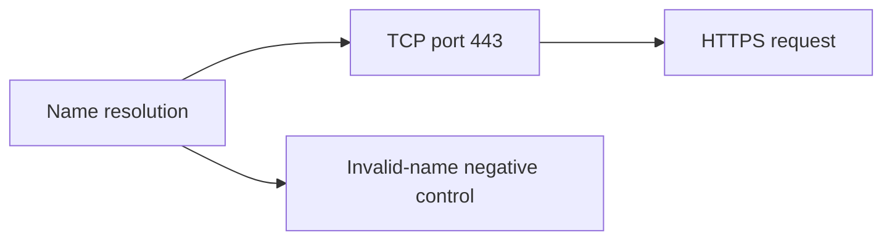

# NET-001 | DNS, TCP and HTTPS Troubleshooting Lab

**A successful DNS lookup does not prove that a website works.** This Windows networking lab checks name resolution, TCP connectivity and an HTTPS response separately, then uses an intentionally invalid name as a negative control.

**Status:** Executed and documented on November 2, 2026.  
**Environment:** Local Windows machine with PowerShell, DNSClient and NetTCPIP.  
**Execution:** Agent-assisted commands run on the account owner's machine with authorization. This is a personal learning lab, not production IT experience or an incident response engagement.

## Objective

Practice a repeatable help desk workflow for a report such as "a website will not open." Establish a known-good baseline and identify exactly which layer a result supports before changing settings.



## Results from the recorded run

| Check | Target | Observed result | What it supports |
|---|---|---|---|
| DNS A-record lookup | `example.com` | Two A records returned; addresses omitted | The Windows resolver returned IPv4 address records for this name at test time |
| TCP connection, attempt 1 | `example.com`, port 443 | `true` | A TCP connection to that service port succeeded |
| TCP connection, attempt 2 | Same target and port | `true` | A second connection attempt also succeeded; this is not a long-term reliability measurement |
| HTTPS GET | `https://example.com/` | HTTP 200; content received | The tested HTTPS request completed successfully through the machine's configured network path |
| Negative DNS control | `network-lab.invalid` | `NameDoesNotExist` | An intentionally invalid name failed to resolve as expected |

The authoritative sanitized record is [evidence/results.json](evidence/results.json). The script reports an error if the expected baseline or negative control differs.

## Method

1. Query A records using `Resolve-DnsName -Type A -DnsOnly`. Retain only the number of records and whether an address was returned.
2. Run two `Test-NetConnection -Port 443 -InformationLevel Quiet` checks. Keep only the boolean connection results.
3. Send one HTTPS GET with `Invoke-WebRequest`, using normal certificate validation. Keep only the status code and whether content was received.
4. Query a deliberately invalid name. Check for the DNS name-error identifier rather than treating every exception as an expected failure.
5. Save an allowlisted evidence object, avoiding raw network configuration and address output.

`example.com` and `.invalid` are listed in the [IANA special-use domain registry](https://www.iana.org/assignments/special-use-domain-names). The invalid-name query is a controlled failure, not a fault discovered in the home network.

## How I would use this workflow in a support ticket

| Finding | Next investigation |
|---|---|
| A valid target does not resolve | Confirm the exact name; compare another approved known-good name; distinguish a name error from timeout or local permission restrictions |
| DNS works, but TCP 443 fails | Investigate the destination service and the permitted network path; consider routing, firewall or proxy policy without assuming which one is responsible |
| TCP works, but HTTPS fails | Examine the actual TLS or HTTP error, certificate validation, redirects, authentication and configured proxy behavior |
| Baseline works, but the reported site fails | Compare that site's exact error and scope; investigate browser, account or application-specific behavior |

Document the exact symptom, test time, scope and results before escalating. A single failed tool command is not enough to diagnose an outage.

## Reproduce

From the root of this lab folder, on a Windows PowerShell environment with the required modules:

```powershell
.\scripts\Test-NetworkLayers.ps1
```

The script makes a small number of read-only requests and writes `evidence/results.json`. Follow your organization's approved script-execution process. A rerun replaces the local result record and may produce different results as network conditions change.

## Interpretation limits

- Resolver output may be served from cache. This run does not identify which DNS server answered or prove the DNS transport path.
- A TCP success does not validate TLS, HTTP, authentication or application features.
- HTTP 200 and received content demonstrate one completed request; they do not validate an entire website, every endpoint or all users' access.
- An HTTPS client can use configured intermediaries. This lab does not establish that its path is identical to the TCP test path.
- Two successful connections do not establish uptime, throughput, latency guarantees or overall network security.
- The invalid-name control does not test a real DNS outage. No production outage, security threat or remediation is claimed.

## Evidence and privacy

Only the sanitized result object is published. It contains no exact IP addresses, full MAC addresses, resolver addresses, public WAN IP, machine names, operating-system usernames, household device identifiers or credentials. The JSON is a generated result summary from the executed script, not a raw terminal screenshot or a manually fabricated transcript.

## References

- [Microsoft: Resolve-DnsName](https://learn.microsoft.com/en-us/powershell/module/dnsclient/resolve-dnsname)
- [Microsoft: Test-NetConnection](https://learn.microsoft.com/en-us/powershell/module/nettcpip/test-netconnection)
- [IANA: Special-use domain names](https://www.iana.org/assignments/special-use-domain-names)

**Skills demonstrated:** Windows networking fundamentals, DNS troubleshooting, TCP versus application-layer checks, negative controls, PowerShell automation, evidence handling and clear support documentation.
